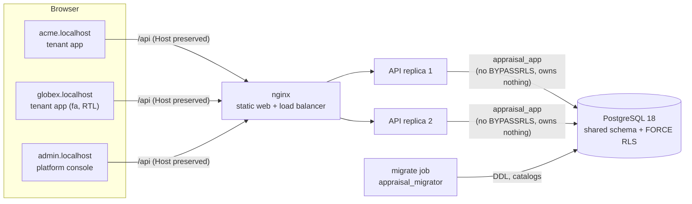
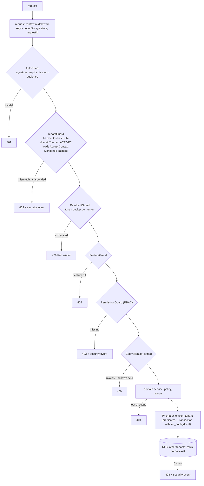
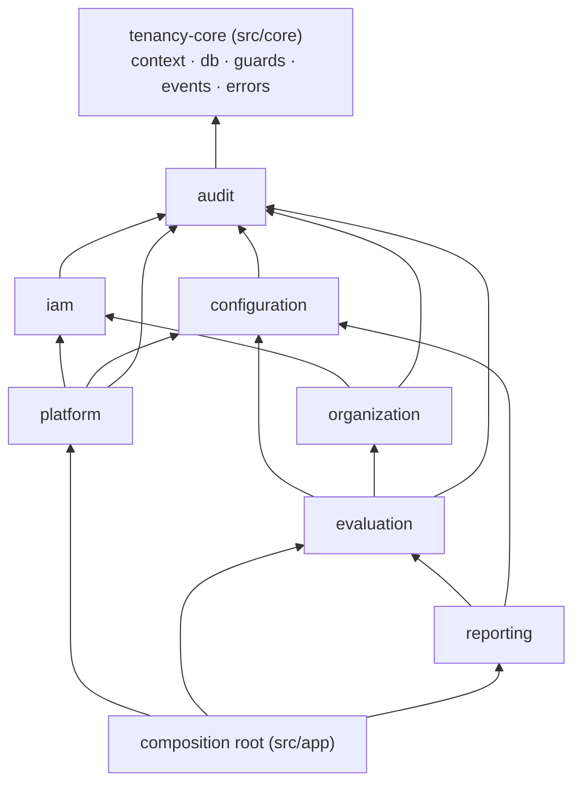
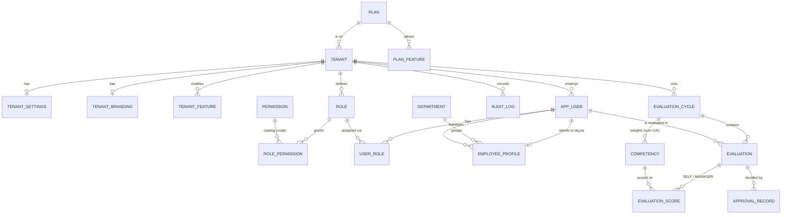
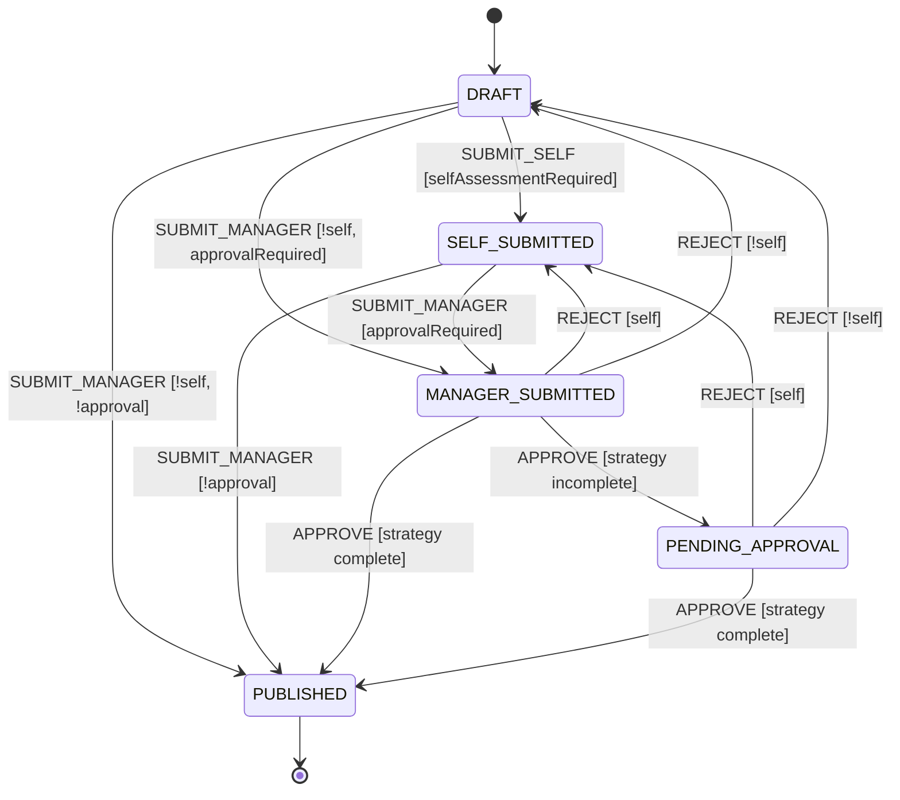

# Architecture

This document is the implementation-level companion of the phase-1 design ("فاز ۱ — معماری و تحلیل
پروژه SaaS چندمستاجری"). Decisions are recorded as ADRs in [`adr/`](adr); measurements in
[`experiments/`](experiments).

## 1. Context



One build of the web app serves every tenant; the sub-domain picks tenant app, platform console or
landing page at runtime. The API is stateless (JWT + refresh tokens in the database, caches keyed
by versions read from the database), so replicas need no coordination (NF-10).

## 2. Request pipeline

Every request passes the gates of the phase-1 diagram, implemented one class per gate and
registered in this order (`src/app/app.module.ts`):



A route without an access decorator makes the application refuse to start
(`RouteRegistry.verify`), so the pipeline cannot be skipped by omission.

## 3. Five layers of tenant isolation

| # | Layer | Mechanism | Catches | Proof |
| --- | --- | --- | --- | --- |
| 1 | Application | tenant context required; tenant models throw without it | a code path that forgot the tenant | `rls.spec.ts` (layer 1) |
| 2 | Query | Prisma extension adds `tenantId` to every where/data; unknown ops fail | a forgotten `where` | `tenant-scope.spec.ts` |
| 3 | Database | `FORCE ROW LEVEL SECURITY` + policy on all 17 tenant tables | bugs in 1–2, raw SQL | matrix in RLS-only mode; catalog check |
| 4 | Integrity | composite FKs `(tenant_id, id)` | a reference into another tenant | `rls.spec.ts`, matrix "injection" |
| 5 | Tests | E1 matrix generated from the route registry | regressions on new endpoints | CI |

## 4. Modules and boundaries



| Module | Owns | Public API (index.ts) |
| --- | --- | --- |
| platform | tenant, tenant_directory, platform_admin, platform_refresh_token, platform_audit_log | TenantDirectoryService (TenantLookup port), PlatformAuthService, TenantsService |
| iam | app_user, role, role_permission, user_role, refresh_token, tenant_authz_state | AuthzService, UserDirectory, IamProvisioning |
| configuration | tenant_settings, tenant_feature, tenant_branding | ConfigurationService |
| organization | department, employee_profile | OrgDirectory |
| evaluation | evaluation_cycle, competency, evaluation, evaluation_score, approval_record | EvaluationReadModel |
| reporting | none (reads through evaluation) | n/a |
| audit | audit_log | sanitizeMetadata |

Enforced by `apps/api/.dependency-cruiser.cjs` (no cycles, `index.ts` only, allowed-edge table,
core is a leaf). Database-level foreign keys between modules' tables are allowed; reading another
module's table in code is not.

## 5. Data model



Platform scope (no `tenant_id`, no RLS): `tenant`, `tenant_directory`, `plan`, `plan_feature`,
`feature_definition`, `permission`, `platform_admin`, `platform_refresh_token`,
`platform_audit_log`. Everything else is tenant scope. Ids are PostgreSQL 18 `uuidv7()`:
unguessable, time-ordered (append-only B-tree inserts, keyset pagination by id).

## 6. Evaluation state machine



`MANAGER_SUBMITTED` = waiting for the first approval decision; `PENDING_APPROVAL` = partially
approved (TWO_STAGE, stage 1 done). The policy is a snapshot taken when the cycle is created. The
whole transition table for all four policy combinations is a reviewed snapshot test.
Transitions use optimistic concurrency (`UPDATE … WHERE version = $expected`).

## 7. Customisation ladder (as implemented)

| Level | Mechanism | Where |
| --- | --- | --- |
| 0 Branding | `tenant_branding` → CSS variables, language, direction | `configuration`, `apps/web/src/lib/theme.ts` |
| 1 Features | `tenant_feature` ∩ plan → FeatureGuard (404) + navigation | `@RequireFeature` |
| 2 Parameters | versioned JSONB validated by Zod, layered default → plan → tenant | `contracts/src/policy.ts` |
| 3 Strategies | `ApprovalStrategy` (SINGLE, TWO_STAGE) chosen by `approvalStrategy` | `evaluation/domain/approval-strategy.ts` |
| 4 Tenant code | forbidden; ESLint fails on comparing a tenant slug/id with a literal | `eslint.config.mjs` |

## 8. Security controls (threat model T1–T14)

| Threat | Control | Test |
| --- | --- | --- |
| T1 IDOR across tenants | RLS + scoped queries, uniform 404 | isolation matrix |
| T2 forgotten tenant filter | RLS, layer 1 refusal | matrix in RLS-only mode |
| T3 context leak on pooled connections | `set_config(..., true)`; session SET never used | 200 concurrent ops; single-connection test |
| T4 tenant spoofing via input | tenant only from context; strict schemas | mass-assignment tests |
| T5 token of A on B's host | `tid` = sub-domain check, separate audiences | auth e2e |
| T6 privilege escalation | RBAC from server-side roles, audited denials, versioned cache; grant ceiling (cannot grant or manage beyond own permissions); last-admin invariant under row lock | RBAC e2e (incl. privilege-ceiling suite) |
| T7 platform admin as target | separate identity, no route to evaluation data | platform e2e |
| T8 suspended tenant keeps working | status checked every request (5 s cache, local invalidation) | platform e2e |
| T9 noisy neighbour | per-tenant token bucket, `statement_timeout`, page caps | E4 |
| T10 side channels | cache keys contain tenant; logs redact scores/comments/secrets; generic errors | logging unit test |
| T11 enumeration | identical 404 body for missing and foreign | matrix |
| T12 audit tampering | runtime INSERT/SELECT only + append-only trigger | `rls.spec.ts` |
| T13 brute force | limiter per (tenant, ip, email) and (tenant, ip); constant-time path with dummy argon2 | auth e2e |
| T14 over-privileged runtime role | migrator vs runtime, no BYPASSRLS, owns nothing | `rls.spec.ts` |

Additional: argon2id (m = 19 MiB, t = 2), access token 15 min in memory only, refresh token
rotation with reuse detection (family revocation; a 10 s grace window distinguishes a benign
double refresh from theft; absolute session lifetime of 30 days), httpOnly + SameSite=Strict cookies without
`Domain`, helmet headers, CORS limited to the platform's own sub-domains, CSV formula-injection
neutralised, 100 kB body limit, RFC 9457 problem details with request id.

## 8a. Front-end architecture

```
apps/web/src
  main.tsx              host → app (tenant / platform / landing); MotionConfig, color mode, React Query
  app/tenant            boot sequence (public branding → silent refresh → /me/context) and routes
  features/<name>       one folder per feature: page(s) + api.ts (typed hooks); no cross-feature internals
  shared/ui             design system: Button, Card, Field, Badge, Table, Stat, Rating, Segmented,
                        Skeleton, QueryState, charts, CommandPalette, motion presets
  shared/lib            api client, query-key factory, theming, color mode, host detection
  shared/i18n           en/fa messages, Intl formatting (Persian calendar and digits for fa)
```

- **Design tokens** live in CSS variables; the tenant sets only `--brand` and `--brand-2`, every tint,
  ring and dark-mode-readable variant is derived with `color-mix`. Light and dark themes, local
  variable fonts (Inter, Vazirmatn), logical properties for RTL.
- **Motion** (Motion for React): route transitions, staggered page entrance, an animated navigation
  indicator (`layoutId`), count-up KPIs, charts that grow in, a score ring, and a journey stepper that
  draws the *policy-pruned* state machine (2 steps for Globex, 4–5 for Acme). Everything honours
  `prefers-reduced-motion` (MotionConfig + a CSS guard).
- **UX**: skeletons instead of spinners, toasts for every mutation, Ctrl/⌘ K command palette built from
  the same permission-filtered navigation, collapsible sidebar, mobile drawer.
- **Data layer**: TanStack Query with a query-key factory; mutations invalidate by key prefix.

## 9. Known limitations

- Rate limits are per instance (R replicas ⇒ up to R × the budget); Redis only when exactness matters.
- Per-tenant restore requires a filtered export (cost of the shared schema).
- Users belong to exactly one tenant; SSO/SAML, e-mail delivery, file uploads, custom domains out of scope.
- Prisma 7's adapter executes some relation sub-queries concurrently inside a transaction, which
  `pg` 8 reports as a deprecation warning; harmless today, to be revisited with `pg` 9.
- Docker Compose files are provided but could not be exercised on the development laptop (Docker
  Desktop failed to start); the same steps were run natively (see README). The CI workflow mirrors
  them but has not run yet, because the repository has not been pushed anywhere.
